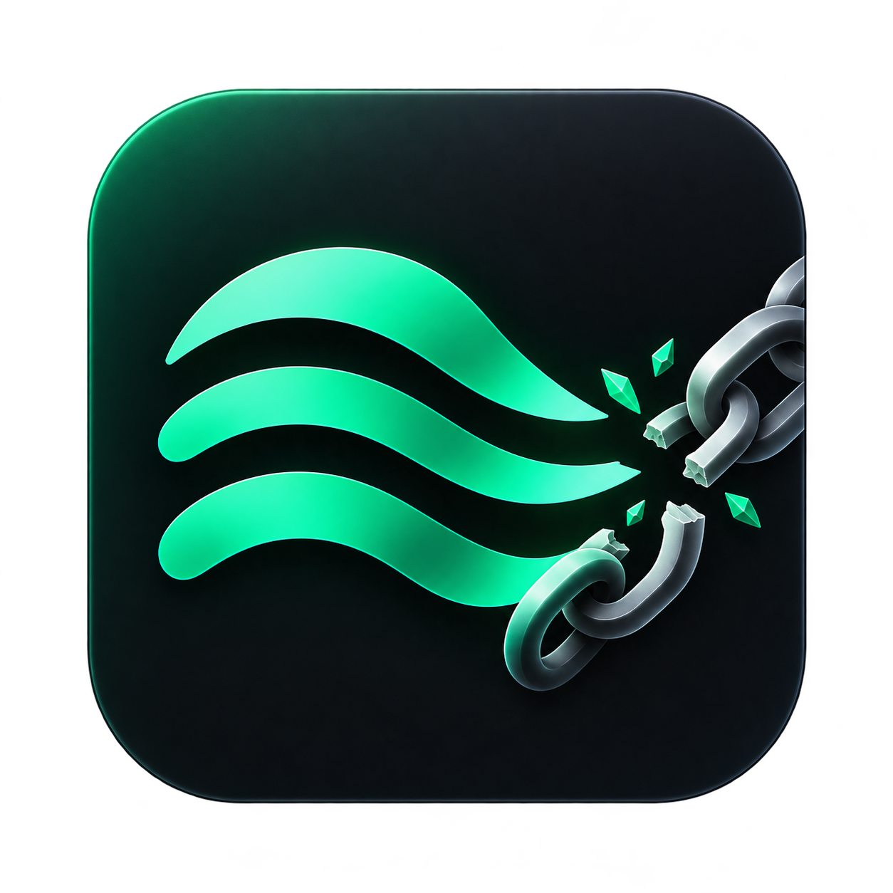
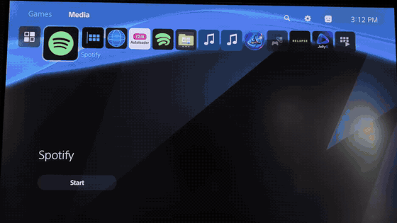

<h1 align="center">Spotless</h1>

Your Spotify. Your console. No PSN required.

<a href="INSTALL.md">Install</a> · <a href="docs/PACKAGES.md">Prepare a package</a> · <a href="docs/TROUBLESHOOTING.md">Troubleshooting</a> · <a href="docs/DEVELOPMENT.md">Development</a>

Spotless is a PS5 payload that lets the native Spotify app sign in with your
Spotify account without linking a PlayStation Network account. Load it once from a
jailbroken session and Spotify keeps working on every launch after that, including
background playback with the console's own music controls.

## Demo

## Features

- Spotify sign-in with the on-screen code or Spotify Connect from your phone
- Home, search, browsing, songs and videos: everything the native app offers
- Spotify Connect playback control from your phone
- Background playback while you play games
- Pause, previous and next from the Now Playing card
- One-time setup: the patch persists across app launches and reboots
- `Spotless-Restore.elf` puts the original app back

## Compatibility

| Component | Tested |
| --- | --- |
| Firmware | **13.00** |
| Spotify | **01.017.000** (PPSA05688) |
| Loader | Any ELF loader or Payload Manager |

Only the configuration above has been tested by the maintainer. Spotify 01.017.000
requires firmware 12.00 or later. Spotless checks the cached frontend before
patching and refuses versions it does not recognise, so an unsupported app version
fails safely.

### Community reports

Tried Spotless on your console?
[Submit a compatibility report](https://github.com/abhi245y/spotless/issues/new?template=compat_report.yml);
this table updates automatically.

<!-- compat:start -->
| Firmware | Status | Reports |
| --- | --- | --- |
| 13.60 | Works | [1 works, 0 does not](https://github.com/abhi245y/spotless/issues?q=label%3Acompat-report%20%2213.60%22) |
| 12.70 | Works | [1 works, 0 does not](https://github.com/abhi245y/spotless/issues?q=label%3Acompat-report%20%2212.70%22) |
| 9.60 | Works | [1 works, 0 does not](https://github.com/abhi245y/spotless/issues?q=label%3Acompat-report%20%229.60%22) |
<!-- compat:end -->

## Known limitations

- **Music > Music sources > Spotify** still shows *Link* and opens Sony's
  account-linking flow. Ignore it; Spotify itself is already signed in and playing.

## Quick start

You need a PS5 with a working jailbreak and an ELF loader. Spotless does not
jailbreak the console.

1. Install Spotify 01.017.000. See [Prepare a package](docs/PACKAGES.md).
2. Load `Spotless.elf` with your ELF loader or Payload Manager.
3. Open Spotify and wait on the login screen for the *UI patch installed* notification.
4. Close Spotify fully, reopen it and sign in.

The [installation guide](INSTALL.md) covers checksums, notifications, persistence
and restoring the original app.

## Download

Get `Spotless.elf` and `Spotless-Restore.elf` from
[Releases](https://github.com/abhi245y/spotless/releases), or
[build from source](docs/DEVELOPMENT.md). Each file ships with a SHA-256 checksum.

## How it works

Spotify on PS5 runs a web frontend from the app's cache. Spotless waits for that
cache to be populated, verifies it against known hashes, saves a backup and
applies a small set of edits to the console's own copy. No Spotify code is
included in this repository or the payload. The patch lets the
frontend accept a normal Spotify session without Sony account linking, while
playback continues to use the console's native player. Details are in
[Development](docs/DEVELOPMENT.md).

## Credits

- [Spot5](https://github.com/abhi245y/spot5), the earlier project this grew out of
- [librespot-ps5](https://github.com/stupiditytries/librespot-ps5), for showing that a working route existed
- [PS5Upload](https://github.com/phantomptr/ps5upload), used by the optional cleanup tool

## License

Spotless is released under the [GNU General Public License v3.0](LICENSE).

## Disclaimer

Spotless is an independent community project, not affiliated with Spotify or Sony
Interactive Entertainment. It does not distribute Spotify packages, accounts or
subscriptions. Use it at your own risk.
